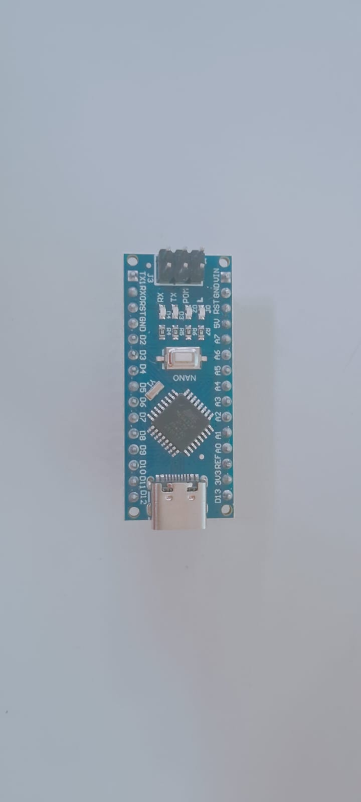
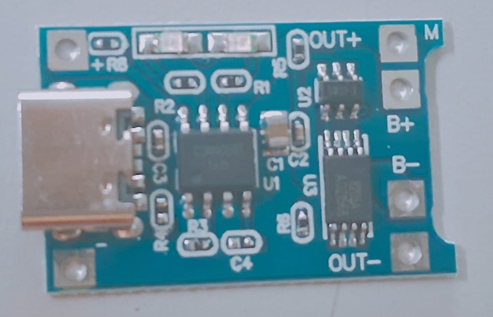
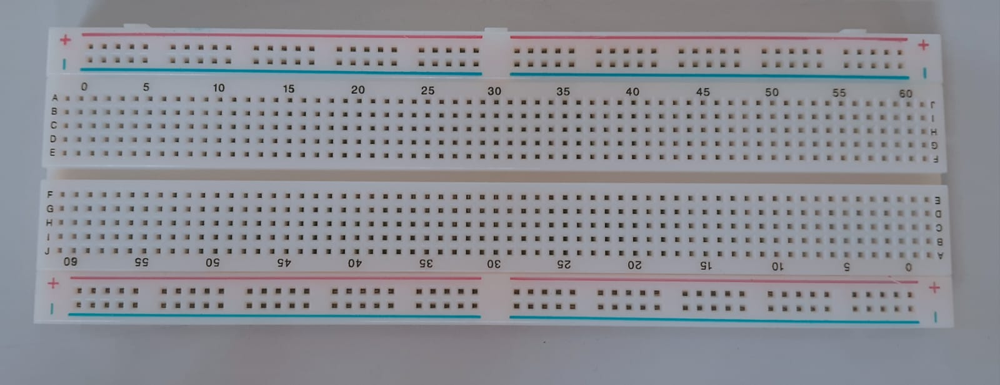
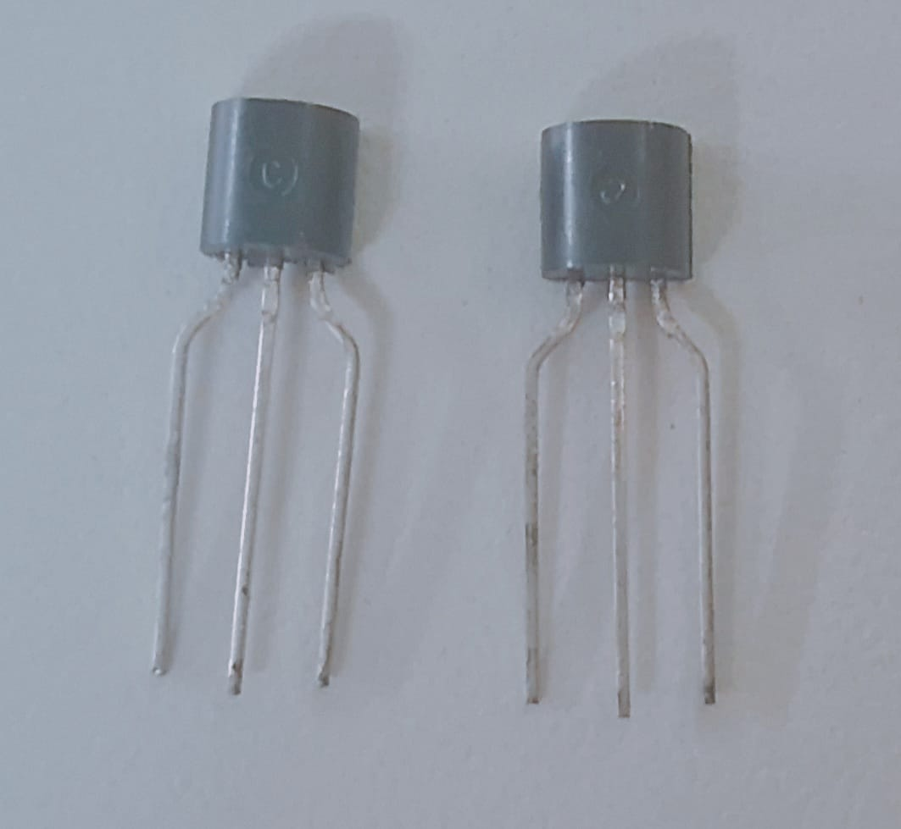
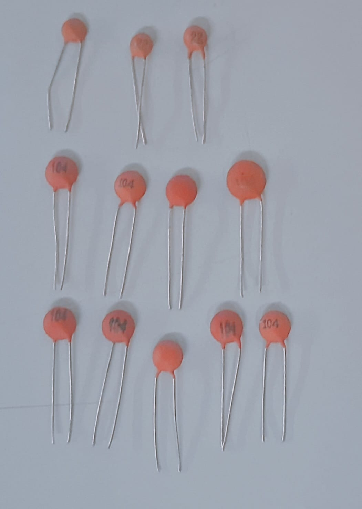
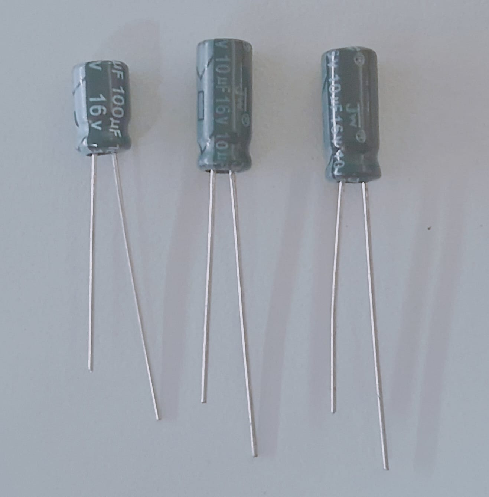
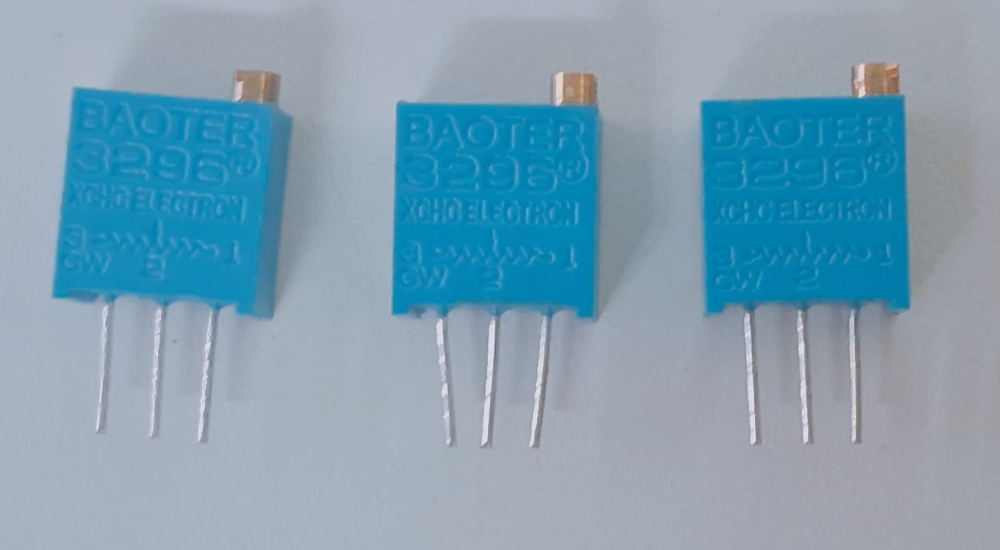
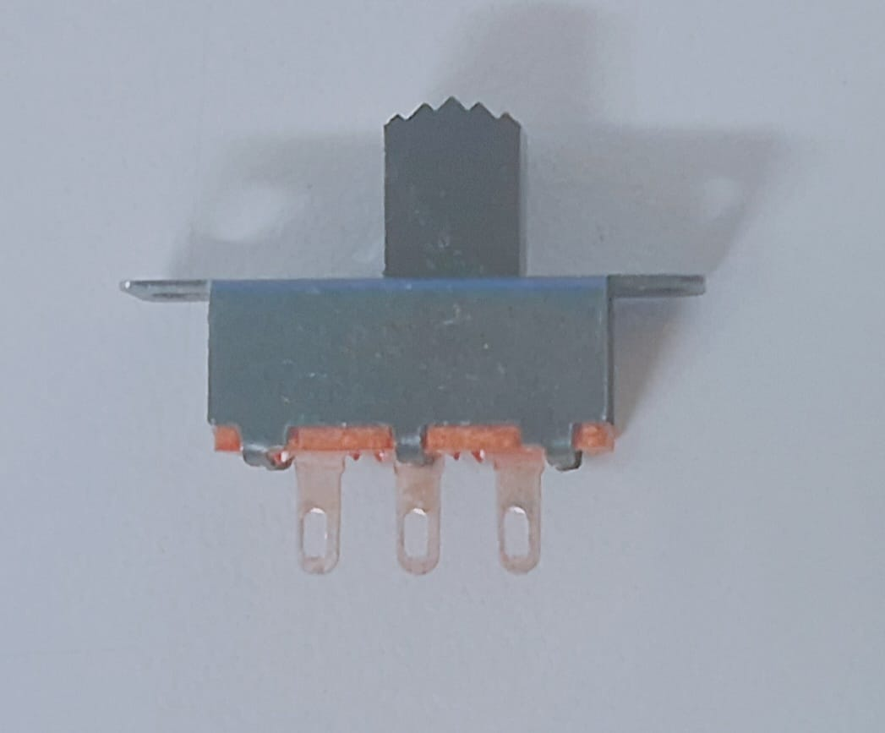

# Caracterización Óptica de Medios Turbios para Diagnóstico Médico No Invasivo de la Trombosis Venosa Profunda (TVP) y Masas Tisulares

# :book: Introducción
El acceso equitativo y oportuno a métodos de diagnóstico médico representa uno de los mayores retos de la salud pública en el Perú y a nivel global :earth_americas:. Actualmente, la evaluación de patologías vasculares como la Trombosis Venosa Profunda (TVP), la isquemia muscular o la caracterización de masas tisulares depende fuertemente de tecnologías de imagenología convencional como la tomografía axial computarizada (TAC), la resonancia magnética (RM) y la ecografía Doppler. Si bien estos métodos ofrecen alta resolución espacial, su implementación masiva enfrenta graves limitaciones estructurales.

# :clipboard: Estructura

### 1. Problemática :pushpin:

###### :hospital: Saturación e Inoperatividad de Equipos de Imagenología Médica Públicos:
En el sistema de salud público (MINSA y EsSalud), los reportes de organismos de control señalan un porcentaje significativo de tomógrafos, resonadores magnéticos y ecógrafos Doppler inoperativos debido a la falta de mantenimiento preventivo y al sobreuso por alta demanda. Esto genera listas de espera para exámenes especializados de entre 1 a 3 meses, un tiempo crítico donde patologías vasculares pueden evolucionar hacia complicaciones mortales, mientras que un tumor no detectado puede progresar aceleradamente de una etapa localizada a fases metastásicas.

###### :man_health_worker: Déficit y Centralización de Personal Especializado en lectura de Imágenes Diagnósticas:
La operación e interpretación de ecografías Doppler y tomografías requieren médicos radiólogos y especialistas en tiempo real. En el Perú, existe una severa brecha de especialistas, concentrados principalmente en Lima y grandes capitales de región. Esta centralización deja a miles de peruanos en centros de salud de atención primaria sin personal capacitado para interpretar imágenes complejas, provocando diagnósticos erróneos o retrasos prolongados en la derivación de pacientes.

###### :moneybag: Inaccesibilidad Económica por el Alto Costo de exámenes de Imagenología Especializada:
En el sector privado, el costo de una tomografía o resonancia oscila entre S/. 500 y S/. 2,500 soles, un monto prohibitivo para familias de bajos recursos económicos, obligándolos a postergar sus exámenes diagnósticos y arriesgar su vida por motivos financieros. Asimismo, estos equipos requieren instalaciones complejas (blindaje contra radiación, acondicionamiento ambiental estricto y suministro eléctrico continuo de alta potencia), imposibilitando su despliegue en postas de salud rurales o periféricas.

###### :moneybag: Imposibilidad de Diferenciación Temprana entre Tumores Benignos, Malignos y Coágulos en Triaje Primario:
Los métodos de palpación manual o evaluación física básica en triaje son incapaces de caracterizar la naturaleza de una masa tisular o diferenciar un coágulo de un proceso neoplásico. Sin herramientas ópticas cuantitativas, no es posible evaluar el grado de angiogénesis, hipervascularización típica de tumores malignos frente a la baja vascularización de una masa benigna o la oclusión total por un trombo, lo que retrasa la derivación prioritaria del paciente a una biopsia o a un tratamiento anticoagulante inmediato. 

###### :house_with_garden: Desprotección en Zonas Rurales y Centros de Atención Primaria en Equipos de Imagenología:
Muchas postas médicas rurales (niveles I-1 e I-2) operan con equipamiento mínimo o casi nulo. Un paciente con sospecha de coágulo en una zona alejada no cuenta con herramientas de descarte local y debe ser trasladado por carreteras accidentadas durante horas, aumentando exponencialmente el riesgo de desprendimiento del coágulo y embolia pulmonar.

###### :detective: Peligrosidad de Patologías Asintomáticas:
Aproximadamente el 50% de los pacientes con Trombosis Venosa Profunda y una fracción considerable de tumores benignos o malignos, no manifiestan sintomatología clínica evidente en etapas tempranas. Cuando los síntomas agudos aparecen, la condición suele estar en fase avanzada. Por ende, la ausencia de dispositivos portátiles de bajo costo para el tamizaje rutinario en triaje impide la detección precoz de estas condiciones en la población general.

### 2. Aplicación :pushpin:
Se propone el desarrollo y mejoramiento de un sistema de caracterización y diagnóstico óptico no invasivo, portátil y de ultra bajo costo que medirá las concentraciones de oxihemoglobina Δ[HbO₂] y desoxihemoglobina Δ[Hb] mediante luz y sensores IR. Utilizando las propiedades de transporte de radiación electromagnética no ionizante en medios turbios (tejidos biológicos) y la Ley de Beer-Lambert para traducir densidades ópticas en datos de Δ[HbO₂] y Δ[Hb]. El dispositivo permite realizar descartes rápidos en triaje o atención primaria en un par de minutos, sin requerir personal altamente especializado ni infraestructura compleja.

### 3. Antecedentes :pushpin:
La necesidad de detectar trombos y masas tumorales sin cirugías exploratorias impulsó, desde mediados del siglo XX, el desarrollo de la imagenología moderna. Aunque la llegada del ultrasonido Doppler, la tomografía y la resonancia magnética consolidó el estándar de oro diagnóstico, su elevado costo e infraestructura limitaron su uso a hospitales de alta complejidad. Para cubrir este vacío en la atención primaria, en los años 90 emergió la biofotónica como una alternativa no invasiva, portátil y de bajo costo basada en la interacción de la luz infrarroja con el tejido biológico [1]. Es en esta evolución donde se enmarca el presente proyecto, buscando optimizar la detección vascular mediante un sistema óptico multicanal accesible.

Partiendo de estos fundamentos, en los últimos años diversas investigaciones han explorado alternativas ópticas e infrarrojas para superar las limitaciones de accesibilidad y costo que presentan las técnicas estándar de imagenología médica [2], [3]. En el ámbito de la termografía infrarroja (TIR), diversos autores evaluaron la asimetría térmica de la piel como indicador indirecto de alteraciones hemodinámicas y procesos inflamatorios agudos asociados a eventos trombóticos o vasculares [4], [5]. Estudios clínicos preliminares, como los desarrollados en modelos animales por Deng et al. [6] y en cohortes de pacientes con sospecha de trombosis venosa profunda (TVP), reportaron altos niveles de sensibilidad entre 88.3% y 96.88% mediante el uso de termografía infrarroja digital como herramienta adyuvante al ecógrafo Doppler en extremidades inferiores [7], [8], [9] o arteria femoral [10]. Sin embargo, la literatura coincide en que la termografía ofrece un desempeño moderado en especificidad frente al Doppler color debido a su alta susceptibilidad a factores ambientales y a que solo mide la radiación térmica superficial cutánea [7]. A partir de estos hallazgos, para el desarrollo de nuestro dispositivo se decide prescindir del monitoreo meramente térmico como técnica principal, reemplazándolo o complementándolo con una arquitectura de detección por espectroscopía activa, la cual permite interrogar directamente el volumen tisular subyacente y reducir la variabilidad por ruido ambiental.

Por otro lado, la Espectroscopía de Infrarrojo Cercano (EINC) y la Reografía de Reflexión de Luz (RRL) han demostrado ser técnicas sólidas y no invasivas para la caracterización vascular y la evaluación hemodinámica cuantitativa [11]. Trabajos pioneros de Scott et al. [12], Korah et al. [13] y Arora et al. [11] establecieron la factibilidad de utilizar dispositivos EINC portátiles para monitorear en tiempo real las variaciones relativas de hemoglobina oxigenada (HbO2) y desoxihemoglobina (HHb) mediante maniobras de provocación vascular. De igual forma, investigaciones clínicas llevadas a cabo por Li et al. [14], Yamaki et al. [15] y Hosoi et al. [16], [17] confirmaron que la NIRS presenta una elevada sensibilidad de hasta del 97% en la evaluación del flujo venoso, el reflujo y la recanalización en la pantorrilla, superando a métodos como la pletismografía por aire, técnica que mide cambios de volumen mediante un brazalete inflable en la pierna, especialmente en la detección de patologías vasculares distales. No obstante, la mayoría de estos desarrollos se enfocan tradicionalmente en equipos voluminosos de laboratorio y poco portátiles, o sistemas monocanal. Esta última configuración impide separar la información de la piel superficial del tejido profundo, limitando su capacidad a detectar únicamente oclusiones venosas severas o muy avanzadas. Para nuestro diseño, se propone modificar la geometría de la sonda implementando un arreglo optoelectrónico multicanal con distancias emisor-detector optimizadas (1.5cm a 3.5cm), permitiendo restar el efecto de la capa cutánea superficial y diferenciar tanto estasis venosa como hipervascularización tumoral.

Finalmente, el desarrollo reciente de instrumentación optoelectrónica dedicada ha enfatizado la necesidad de garantizar estabilidad técnica a bajo costo, trabajos como el de Zhao et al. [18] destacan que el éxito clínico de un monitor NIRS portátil reside en la supresión activa del ruido oscuro, la compensación de deriva térmica y la inmunidad frente a interferencias electromagnéticas. Tomando como referencia estas recomendaciones, nuestro proyecto adoptará un sistema de iluminación multiespectral pulsada (660nm y 850nm) junto con un módulo de amplificación de transimpedancia (AMP-TI) y filtrado pasa-banda activo. Estas modificaciones permitirán obtener un prototipo robusto, inmune a la luz ambiental y de ultra bajo costo, apto para su despliegue en centros de atención primaria y triaje.

### 4. Objetivo :pushpin:
### 4.1. :dart: Objetivo General:
Desarrollar un prototipo de caracterización y diagnóstico óptico no invasivo, portátil y de bajo costo, basado en Espectroscopía de Infrarrojo Cercano multicanal, para estimar las variaciones hemodinámicas de oxihemoglobina ($\Delta[\text{HbO}_2]$) y desoxihemoglobina ($\Delta[\text{Hb}]$) en tejido biológico, orientado al tamizaje de Trombosis Venosa Profunda y la diferenciación de masas tisulares en centros de atención primaria.

### 4.2. :dart: Objetivo Específicos:
1. **Diseño de la Sonda Óptica:**
   - Diseñar una geometría de sonda con un arreglo optoelectrónico multicanal a distancias de 1.5 cm a 3.5 cm entre emisores y detectores, para desacoplar ópticamente las señales del tejido cutáneo superficial de las capas profundas subyacentes.
2. **Implementación del Hardware Electrónico:**
   - Implementar el circuito de iluminación pulsada multiespectral (660 nm y 850 nm / 940 nm) y la etapa de fotodetección con componentes portátiles de bajo consumo energético.
   - Construir el módulo analógico de acondicionamiento de señal mediante amplificación de transimpedancia, filtrado pasa-banda activo y supresión de luz ambiental.
3. **Desarrollo del Programa de Control:**
   - Programar en el microcontrolador la adquisición analógica-digital, la conmutación secuencial de diodos emisores de luz y el procesamiento en tiempo real de los índices hemodinámicos.
   - Integrar una interfaz de visualización directa (pantalla de diodos orgánicos de emisión de luz) que presente los resultados de forma rápida e intuitiva para el personal de triaje.
4. **Pruebas de Campo y calibración:**
   - Calibrar y validar la respuesta del prototipo utilizando simuladores tisulares (phantoms) con propiedades de absorción y dispersión conocidas.
   - Evaluar la capacidad del dispositivo para discriminar entre respuestas de estasis venosa e hipervascularización en entornos de ensayo controlados sobre los simuladores de gelatina.
5. **Evaluación de Costos e Impacto:**
   - Demostrar la viabilidad técnico-económica del dispositivo logrando un costo de producción estimado entre S/. 56 y S/. 82, para su potencial despliegue en zonas rurales y centros de atención primaria.

### 5. Metodología Experimental y de Desarrollo 📌
La metodología implementada en este proyecto adopta el enfoque de Aprendizaje Basado en Proyectos (ABP), estructurando el desarrollo del prototipo en tres etapas fundamentales: diseño del hardware optoelectrónico, modelado del procesamiento de señal y un protocolo riguroso de validación experimental en laboratorio [1].

#### 5.1. Arquitectura de Hardware y Sonda Óptica Multicanal
El sistema optoelectrónico está diseñado bajo una arquitectura portátil, modular y de ultra bajo costo (estimado entre S/. 56.00 y S/. 82.00) [1, 6]. La cadena de acondicionamiento de señal comprende las siguientes etapas:

1. **Sonda Optoelectrónica Multicanal:**
   - **Geometría de Detección:** Se implementa un arreglo en reflexión con distancias emisor-detector de 1.5 cm (canal corto) y 3.5 cm (canal largo). La separación de 1.5 cm limita la penetración a la capa cutánea superficial (aproximadamente 0.75 cm), mientras que la distancia de 3.5 cm alcanza el tejido vascular y muscular profundo (aproximadamente 1.75 cm) [1].
   - **Iluminación Pulsada Multiespectral:** Se emplean diodos LEDs en el espectro del infrarrojo cercano (660 nm sensible a desoxihemoglobina Hb, y 850 nm / 940 nm sensible a oxihemoglobina HbO2). Los LEDs son excitados secuencialmente mediante modulación por ancho de pulso (PWM) desde el microcontrolador a frecuencia fija para evitar el sobrecalentamiento [1].
   - **Fotodetección:** Se utiliza un fotodiodo de silicio de alta sensibilidad en el rango visible e infrarrojo cercano (BPW21 o similar) [1].

2. **Acondicionamiento Analógico de Señal:**
   - **Amplificador de Transimpedancia (AMP-TI):** La fotocorriente débil (Iph) generada por los fotones retrodispersados se convierte en una tensión de voltaje medible mediante un amplificador operacional de bajo costo (LM358 o TL081) [1]:
     `Vout = -Iph * Rf`
     donde Rf es la resistencia de realimentación ajustada para la ganancia del canal.
   - **Filtrado Activo y Supresión de Luz Ambiental:** Se incorpora una red RC pasa-bajo (condensadores de 100 nF) para atenuar interferencias de la red eléctrica de 50/60 Hz. El microcontrolador ejecuta un algoritmo de resta activa en tiempo real: lee el voltaje con el LED encendido (Von) y con el LED apagado (Voff), calculando `Vutil = Von - Voff` para cancelar por completo la iluminación de fondo del entorno [1].

3. **Control y Despliegue Directo:**
   - Un microcontrolador de bajo consumo (Arduino Nano / ESP32) realiza la conversión analógico-digital (ADC) de 10/12 bits, aplica las ecuaciones de transporte óptico y despliega las variaciones hemodinámicas en tiempo real sobre una pantalla OLED 128x64 píxeles mediante bus I2C. El sistema es alimentado por una batería Li-ion de 3.7V acoplada a un cargador TP4056 y regulador elevador a 5V [1].

---

#### 5.2. Modelado Físico y Algoritmo de Procesamiento (Ley de Beer-Lambert Modificada)
Para traducir la atenuación de la intensidad luminosa detectada en variaciones cuantitativas de concentración de hemoglobina en tejidos turbios dispersores, el programa del microcontrolador y los scripts de procesamiento en Python aplican la Ley de Beer-Lambert Modificada (MBLL) [1, 18]:

`Delta OD(lambda) = ln(I0(lambda) / I(lambda)) = ( epsilon_HbO2(lambda) * Delta[HbO2] + epsilon_Hb(lambda) * Delta[Hb] ) * r * DPF(lambda) + G`

donde:
- `Delta OD(lambda)` es la variación de densidad óptica atenuada a la longitud de onda lambda [1].
- `I0` e `I` corresponden a la intensidad incidente y detectada, respectivamente [1].
- `epsilon_HbO2(lambda)` y `epsilon_Hb(lambda)` son los coeficientes de extinción molar de cada cromóforo [1].
- `r` es la distancia física entre el LED y el fotodiodo [1].
- `DPF(lambda)` es el Factor de Camino Óptico Diferencial (*Differential Pathlength Factor*) que contabiliza la trayectoria efectiva extendida por la dispersión múltiple en el tejido [1].
- `G` representa el factor de pérdida por geometría del sensor [1].

Evaluando la atenuación en dos longitudes de onda simultáneas (`lambda1 = 660 nm` y `lambda2 = 850/940 nm`), el algoritmo resuelve un sistema de matrices de 2x2 para despejar los valores instantáneos de concentración `Delta[HbO2]` y `Delta[Hb]`. Posteriormente, se aplica la sustracción algorítmica de canales (`Señal_profundo - Señal_superficial`) entre el canal de 3.5 cm y el de 1.5 cm para aislar las señales del paquete vascular o masa tisular profunda [1, 18].

---

#### 5.3. Protocolo de Ensayos Experimentales y Calibración en Laboratorio
Con el fin de validar la confiabilidad, estabilidad y sensibilidad del prototipo frente a estándares de instrumentación médica no invasiva, se implementará un protocolo de laboratorio dividido en cuatro ensayos controlados [1, 18]:

1. **Prueba de Estabilidad Térmica (8 horas):**
   - **Procedimiento:** Se acoplará la sonda optoelectrónica a un simulador tisular (*phantom*) neutro dentro de una cámara oscura a temperatura ambiental controlada (25 °C) [1, 18].
   - **Medición:** Se operará el sistema continuamente durante 8 horas registrando la tensión de salida del fotodiodo (Vout) y monitoreando periódicamente la temperatura del LED emisor y del fotodiodo mediante un termómetro inalámbrico [1, 18].
   - **Criterio de Aprobación:** Comprobar la ausencia de deriva temporal en el voltaje de salida para garantizar que el calentamiento de los componentes no afecte la medición [1, 18].

2. **Prueba de Robustez Ante Interferencias Externas (Mecánica, EMI y Ruido Oscuro):**
   - **Inmunidad a Presión Mecánica:** Se colocará la sonda sobre un *phantom* sólido y se aplicarán cargas mecánicas progresivas (0.5 kg, 1.0 kg y 1.5 kg) sobre la cara posterior de la sonda. Se verificará que la fuerza de sujeción al cuerpo no modifique la respuesta de voltaje del sensor [1, 18].
   - **Interferencia Electromagnética (EMI):** Se ubicará un dispositivo móvil emitiendo llamadas a 10 cm del circuito analógico durante la lectura. Se calculará el porcentaje de ruido por interferencia (NPi), exigiendo un valor inferior al 1% para asegurar el blindaje del amplificador [1, 18]:
     `NPi = | (U_sin_interf - U_con_interf) / U_con_interf | * 100%`
   - **Ruido Oscuro (*Dark Noise*):** Se registrará el offset de voltaje en oscuridad total y con iluminación ambiental variable, requiriendo un porcentaje de ruido inferior al 1% (`NPd < 1%`) [1, 18].

3. **Prueba de Sensibilidad y Linealidad con Phantoms Líquidos/Gelatina:**
   - **Procedimiento:** En un contenedor con 600 mL de solución dispersora turbia (agua con intralipid o emulsión) sobre un agitador magnético, se inyectarán microdosis cuantitativas de tinta china diluida [1, 18].
   - **Medición:** Se registrará la caída escalonada de la densidad óptica al aumentar la concentración de absorbedores en la solución [1, 18].
   - **Criterio de Aprobación:** Validar la linealidad entre el coeficiente de atenuación medido por el fotodiodo y la concentración molar inyectada conforme a la Ley de Beer-Lambert [1, 18].

4. **Prueba Fisiológica In Vivo (*Cuff Experiment* / Experimento del Manguito):**
   - **Procedimiento:** Se colocará un brazalete de esfigmomanómetro en el brazo de un voluntario y se inflará a 140 mmHg durante 3 minutos para inducir una oclusión vascular temporal (simulando estasis venosa/trombosis) [1, 18].
   - **Medición:** Al liberar la válvula, el software registrará las curvas dinámicas de decaimiento y recuperación de oxihemoglobina (`Delta[HbO2]`) y desoxihemoglobina (`Delta[Hb]`) en tiempo real [1, 18].
   - **Criterio de Aprobación:** Comprobar que el algoritmo detecta automáticamente la estasis sanguínea (caída de HbO2 e incremento de Hb) y la respuesta hiperémica reactiva posterior [1, 18].

---
## :electric_plug: Parte Electrónica del Dispositivo

### 6. Diseño del Sistema Electrónico :pushpin:

El sistema electrónico es el :heart: corazón del dispositivo NIRS. Se encarga de generar la señal de luz infrarroja, controlar la emisión, detectar la luz que atraviesa el tejido, convertirla a señal eléctrica, amplificarla y digitalizarla para su procesamiento. Todo diseñado para ser portátil, de bajo costo y bajo consumo.

---

### :jigsaw: Componentes a Utilizar

| Foto | Componente | Función | Recomendación |
|:---:|---|---|---|
|  | :brain: Arduino Nano (versión USB-C) | Cerebro del sistema: controla emisión, lee sensores, procesa datos | Arduino Nano / ESP32 — económico, fácil de programar, suficiente para NIRS |
|  | 🔋 Módulo TP4056 (USB-C + protección) | Carga batería 3.7V desde 5V USB-C con corte automático a 4.2V; protege contra sobrecarga, sobredescarga y cortocircuito; entrega energía por OUT+/OUT- al resto del sistema | Versión con protección integrada (DW01A + MOSFET), conectar batería en B+/B- y salida hacia MT3608 en OUT+/OUT- |
|  | 🧩 Tablero de conexiones sin soldadura| Permite armar y probar circuitos de forma rápida y reutilizable: conecta componentes sin necesidad de soldar, facilita modificar y rearmar el diseño cuantas veces sea necesario | Las líneas rojas = positivo (+) / azul = negativo (GND), van conectadas de forma continua. Las filas A–E y F–J se comunican entre sí por columnas. No tiene polaridad, se puede usar para cualquier parte del circuito|
|  | ⚡ Módulo Elevador MT3608 (HW-183) | Convierte voltaje de entrada bajo (2V–5V, ej: 3.7V de batería) a voltaje mayor estable; entrega 5V regulados por OUT+/OUT- para alimentar Arduino, sensores y pantalla | Ajustar con multímetro antes de conectar la carga: girar el trimmer azul hasta medir 5.0V exactos entre OUT+ y OUT-; conectar entrada desde OUT+/OUT- del TP4056 |
|  | ⚡ Transistor 2N3904 | Actúa como interruptor electrónico controlado por el Arduino: permite encender y apagar secuencialmente cada LED sin que el microcontrolador soporte la corriente directamente | Identificar pines: E (Emisor) → al GND, B (Base) → por resistencia 1kΩ a D2/D3, C (Colector) → al cátodo del LED correspondiente; 2 unidades para controlar LED 660 nm y LED 850 nm |
|  | :battery: Fuente de energía portátil recargable | Proporciona tensión continua estable de 3,7 V para todo el circuito; permite funcionar sin conexión a corriente externa y se recarga repetidamente | Cable naranja = positivo (+), negro = negativo (–). Conectar siempre respetando la polaridad. Usar con módulo cargador/regulador para recargar y elevar a 5 V si es necesario. No cortar ni exponer al calor excesivo |
|  | 🧹 Condensadores cerámicos| Filtran ruido de alta frecuencia y limpian interferencias rápidas en la línea de alimentación; estabilizan cada integrado y acompañan circuitos de señal/reloj | No tienen polaridad: se colocan en cualquier sentido. Colocar un 104 cerca de cada chip (VCC ↔ GND); los 222 junto a etapas de señal o temporizadores para ajustar la respuesta de frecuencia |
|  | 🧹 Condensadores electrolíticos (10 µF y 100 µF / 16 V)| Filtran y estabilizan la línea de alimentación: suavizan variaciones de voltaje, absorben picos de consumo y mantienen energía estable para todo el circuito | Tienen polaridad: patilla larga = positivo (+), corta = negativo (–). Colocar 100 µF cerca de la salida del MT3608 (5V ↔ GND) como reserva de energía; los 10 µF cerca de la entrada de alimentación del Arduino para estabilidad|
|  | 🎚️ Trimmer multivuelta 3296 — 100 kΩ| Ajusta con precisión la ganancia de cada amplificador: define cuánto se amplifica la señal débil del fotodiodo para que se lea bien sin saturarse | 1 por canal (3 unidades). Girar el tornillo con destornillador pequeño: aumenta ganancia al girar en un sentido, disminuye en el otro. Ajustar hasta que la señal varíe claramente al tapar/destapar el fotodiodo, sin llegar al máximo (1023) ni quedarse en cero|
|  | 💡 Diodos LED — Rojo, Azul, Blanco| Indicadores visuales: señalan si el circuito está encendido, recibiendo señal o activando una función | Tienen polaridad: patilla larga = positivo (+), corta = negativo (–). Siempre acompañar de resistencia limitadora 220–330 Ω. Colores: Rojo (~1.8–2 V), Azul y Blanco (~3–3.4 V)|
|  | Interruptor deslizante de 3 patillas — 2 posiciones |Conecta o corta el paso de corriente: enciende o apaga el circuito; cambia entre dos modos de funcionamiento según la posición de la palanca |Patilla central = común; al deslizar conecta con una de las dos patillas laterales. Colocar en la línea de positivo de alimentación entre fuente y circuito. No tiene polaridad, funciona en cualquier sentido|
|  | :tv: Pantalla / Indicador | Mostrar resultados en tiempo real | Pantalla OLED 128×64 (I2C) — pequeña, económica y clara |

---

### :gear: Funcionamiento del Circuito

1. :bulb: Emisión: El microcontrolador envía una señal para encender los LEDs IR a frecuencia definida → la luz penetra en el tejido biológico.
2. :eye: Detección: El fotodiodo capta la luz que regresa → genera una corriente muy pequeña proporcional a la intensidad recibida.
3. :loudspeaker: Amplificación: El amplificador operacional convierte esa señal débil en voltaje medible → ajustamos la ganancia según necesidad.
4. :broom: Filtrado: Se eliminan interferencias de luces externas y ruido eléctrico.
5. :bar_chart: Conversión A/D: El microcontrolador lee el voltaje → convierte a valor numérico.
6. :abacus: Cálculo: Aplica la Ley de Beer-Lambert → calcula cambios en concentraciones de oxihemoglobina y desoxihemoglobina.
7. :mobile_phone: Salida: Muestra resultados en pantalla y/o envía datos por USB.

---

### :moneybag: Estimación de Costos

| Componente | Aprox. Precio (S/) |
|---|---:|
| Arduino Nano | 15 – 20 |
| 2 LEDs IR (850nm + 940nm) | 4 – 6 |
| Fotodiodo BPW21 | 5 – 8 |
| Amplificador LM358 | 2 – 3 |
| Pantalla OLED 128×64 | 10 – 15 |
| Batería + módulo carga | 15 – 20 |
| Resistencias, condensadores, cables | 5 – 10 |
| **TOTAL** | **~S/. 56 – 82** |

Costo ultra bajo comparado con equipos comerciales que cuestan miles de dólares.

---

### :white_check_mark: Recomendaciones de Diseño y Montaje

- :straight_ruler: Diseño compacto: Colocar emisor y detector muy juntos (~1–2 cm) para que la luz viaje por el tejido y regrese.
- :shield: Protección: Usar cubierta opaca alrededor del sensor → evitar que la luz ambiente interfiera.
- :zap: Estabilidad: Alimentar los circuitos de amplificación con condensadores cercanos a las patas del chip → reducir ruido.
- :test_tube: Calibración: Probar primero con materiales de propiedades ópticas conocidas antes de pruebas en personas.
- :computer: Código: Encender y apagar los LEDs alternadamente → permite diferenciar la señal de luz del dispositivo vs. luz externa.

---

### :chart_with_upwards_trend: Cronograma del Proyecto — Diagrama de Gantt

| Semana | Actividad | Entregable | Peso | Estado |
|:---:|---|---|:---:|:---:|
| **3** | Definición del problema, objetivos y alcance del proyecto | Propuesta | 15% | :hourglass_flowing_sand: En proceso |
| **4** | Investigación de antecedentes y elaboración del Estado del Arte | Documento Estado del Arte | — | :clock5: Pendiente |
| **5** | Planificación detallada: lista de componentes, presupuesto y cronograma | Plan de Proyecto | 20% | :clock5: Pendiente |
| **6** | Diseño del sistema electrónico: esquemas y selección final de componentes | Diseño Esquemático | — | :clock5: Pendiente |
| **7** | Montaje en protoboard y conexión de circuitos | Avance de Montaje | — | :clock5: Pendiente |
| **8** | Programación del microcontrolador y pruebas básicas de emisión/recepción | Código + Pruebas Preliminares | — | :clock5: Pendiente |
| **9 – 10** | Calibración del sensor, ajuste de amplificación y filtrado | Informe de Calibración | — | :clock5: Pendiente |
| **11 – 12** | Pruebas con muestras/phantoms y toma de datos experimentales | Resultados Experimentales | — | :clock5: Pendiente |
| **13 – 14** | Análisis de resultados, comparación con referencias y redacción de conclusiones | Borrador de Informe Final | — | :clock5: Pendiente |
| **15** | Revisión por pares, correcciones y ajustes finales | Informe Final Revisado | — | :clock5: Pendiente |
| **16** | Entrega oficial del Reporte Técnico Final | Reporte Técnico Final | 20% | :date: Entrega |

---

### :bar_chart: Resumen de Etapas

| Etapa | Semanas | Duración |
|---|:---:|:---:|
| 1. Propuesta y Definición | 3 | 1 semana |
| 2. Planificación y Estado del Arte | 4 – 5 | 2 semanas |
| 3. Diseño y Montaje Electrónico | 6 – 8 | 3 semanas |
| 4. Programación y Calibración | 9 – 10 | 2 semanas |
| 5. Pruebas y Toma de Datos | 11 – 12 | 2 semanas |
| 6. Análisis, Redacción y Revisión | 13 – 15 | 3 semanas |
| 7. Entrega Final | 16 | 1 semana |

### :checkered_flag: Avance General: 15%

---

## :busts_in_silhouette: Equipo del Proyecto

| Foto | Nombre y Código | Rol |
|:---:|:---|:---|
|  | **Genaro Andres   Bello Oviedo** `Código: 20241476H` | ⚙️ **Responsable del diseño, implementación y pruebas del sistema electrónico** — Diseño de circuitos, selección de componentes, montaje, conexionado, calibración y verificación del funcionamiento eléctrico y electrónico del equipo |
|  | **Ximena Valentina   Guerra Gonzales** `Código: 20240656B` | :book: **Responsable del estudio de los métodos no invasivos para la detección de TVP** — Estudio, recopilación, análisis y proposición de métodos no invasivos para la detección de TVP y masas tisulares en base a libros y artículos relacionados |
|  | **Bryan Renato   Leon Ive** `Código: 20240541K` | :book: **Responsable del estudio de los métodos no invasivos para la detección de TVP** — Estudio, recopilación, análisis y proposición de métodos no invasivos para la detección de TVP en base a libros y artículos relacionados |
|  | **Bruno Stephano   Ocaña Cruzate** `Código: 20251704C` |:microscope: **Responsable de la coordinación general, fundamentación óptica e innovación tecnológica** — Representación técnica y gestión del equipo; estudio y modelado de la interacción luz-tejido (absorción, dispersión y reflexión óptica en escáneres dérmicos) y definición del valor diferencial e innovador frente a métodos diagnósticos tradicionales | 
|  | **Jairo Jefferson Ortega Vega** `Código: 20220089E` | ⚙️ **Responsable del diseño, implementación y pruebas del sistema electrónico** — Diseño de circuitos, selección de componentes, montaje, conexionado, calibración y verificación del funcionamiento eléctrico y electrónico del equipo |

---

### Referencias :pushpin:

###### Artículos

[2] E. P. Lin, S. Bhatt, y V. S. Dogra, «Lower Extremity Venous Doppler», Ultrasound Clin., vol. 3, no. 1, pp. 115–124, 2008, doi: https://doi.org/10.1016/j.cult.2007.12.005.

[3] S. Goodacre, F. Sampson, M. Stevenson, y A. Ryan, «Measurement of the clinical and cost-effectiveness of non-invasive diagnostic testing strategies for deep vein thrombosis», Health Technol. Assess., vol. 10, no. 15, 2006, doi: https://doi.org/10.3310/hta10150.

[4] S. Enoch y S. D. Blair, «Exclusion of deep vein thrombosis by measuring spot skin temperatures using a hand-held thermo-comparator», Phlebology, vol. 18, no. 1, pp. 23–29, 2003, doi: https://doi.org/10.1258/026835503322598009.

[5] S. Bagavathiappan, T. Saravanan, J. Philip, y K. Jagadeesan, «Investigation of peripheral vascular disorders using thermal imaging», Br. J. Diabetes Vasc. Dis., vol. 8, no. 2, pp. 102–108, 2008, doi: https://doi.org/10.1177/14746514080080020901.

[6] F. Deng, Q. Tang, Y. Zheng, y N. Zhong, «Infrared thermal imaging as a novel evaluation method for deep vein thrombosis in lower limbs», Med. Phys., vol. 39, no. 11, pp. 7010–7015, 2012, doi: https://doi.org/10.1118/1.4764485.

[7] F. Deng, Q. Tang, M. Jiang, y G. Liu, «Infrared thermal imaging and Doppler vessel pressurization ultrasonography to detect lower extremity deep vein thrombosis: Diagnostic accuracy study», Clin. Respir. J., vol. 12, no. 8, pp. 2382–2389, 2018, doi: https://doi.org/10.1111/crj.12639.

[8] X.-T. Liu, Y.-Y. Zheng, Z.-Z. Jian, y Y.-H. Huang, «Diagnostic value of infrared thermography in deep venous thrombosis of lower extremities», Chin. J. Gen. Pract., 2020, doi: https://doi.org/10.16766/j.cnki.issn.1674-4152.001601.

[9] F. Deng, Q. Tang, G. Zeng, y N. Zhong, «Effectiveness of digital infrared thermal imaging in detecting lower extremity deep venous thrombosis», Med. Phys., vol. 42, no. 2, pp. 752–757, 2015, doi: https://doi.org/10.1118/1.4907969.

[10] S.-L. Kang, L. Manojlovich, D. Mroczek, y L. Benson, «Infrared thermography as an adjunctive tool for detection of femoral arterial thrombosis after cardiac catheterization: A prospective, pilot study», Catheter. Cardiovasc. Intervent., vol. 100, no. 2, pp. 215–222, 2022, doi: https://doi.org/10.1002/ccd.30115.

[11] S. Arora, D. J. K. Lam, C. Kennedy, y D. Negus, «Light reflection rheography: A simple noninvasive screening test for deep vein thrombosis», J. Vasc. Surg., vol. 17, no. 3, pp. 541–521, 1993, doi: https://doi.org/10.1016/0741-5214(93)90330-O.

[12] F. D. Scott, K. A. Kang, y G. M. Williams, «Diagnosis of deep vein thrombosis with NIR spectroscopy», en Proc. Annu. Int. Conf. IEEE Eng. Med. Biol. Soc., 1999. URL: https://www.scopus.com/pages/publications/0033330798

[13] L. K. Korah, F. D. Scott, G. M. Williams, y K. A. Kang, «Preliminary studies of the application of near infrared spectroscopy in the diagnosis of deep vein thrombosis», Adv. Exp. Med. Biol., vol. 510, pp. 461–466, 2003, doi: https://doi.org/10.1007/978-1-4615-0075-9_70.

[14] T. Li, Y. Sun, X. Chen, y R. Ren, «Noninvasive diagnosis and therapeutic effect evaluation of deep vein thrombosis in clinics by near-infrared spectroscopy», J. Biomed. Opt., vol. 20, no. 1, p. 010502, 2015, doi: https://doi.org/10.1117/1.JBO.20.1.010502.

[15] T. Yamaki, M. Nozaki, H. Sakurai, y T. Kono, «The utility of quantitative calf muscle near-infrared spectroscopy in the follow-up of acute deep vein thrombosis», J. Thromb. Haemost., vol. 4, no. 8, pp. 1858–1859, 2006, doi: https://doi.org/10.1111/j.1538-7836.2006.01859.x.

[16] Y. Hosoi, H. Yasuhara, T. Miyata, y H. Shigematsu, «Comparison of near-infrared spectroscopy with air plethysmography in detection of deep vein thrombosis», Int. Angiol., vol. 18, no. 4, pp. 334–339, 1999. URL: https://www.scopus.com/pages/publications/0033495971

[17] Y. Hosoi, H. Yasuhara, H. Shigematsu, y T. Muto, «Influence of popliteal vein thrombosis on subsequent ambulatory venous function measured by near-infrared spectroscopy», Am. J. Surg., vol. 178, no. 4, pp. 314–316, 1999, doi: https://doi.org/10.1016/S0002-9610(98)00314-6.

[18] K. Zhao, B. Pan, Z. Li, y T. Li, «Performance evaluation for a novel optoelectronic device for noninvasive monitoring thrombosis», Microelectron. Reliab., vol. 83, pp. 201–207, 2018, doi: https://doi.org/10.1016/j.microrel.2018.03.021.

###### Libros
[1]. **Tuchin, V. V.** (2000). *Tissue Optics: Light Scattering Methods and Instruments for Medical Diagnosis*. SPIE Optical Engineering Press.

   📖 [ISBN: 978-0-8194-3459-3](https://doi.org/10.1117/3.353604)
   
[19]. **Wang, L. V., & Wu, H.** (2012). *Biomedical Optics: Principles and Imaging*. John Wiley & Sons.

   📖 [ISBN: 978-0-470-17700-6](https://doi.org/10.1002/9780470177013)

[20]. **Bigio, I. J., & Fantini, S.** (2016). *Quantitative Biomedical Optics: Theory, Methods, and Applications*. Cambridge University Press.

   📖 [ISBN: 978-0-521-87656-8](https://doi.org/10.1017/CBO9780511805347)

[21]. **Keiser, G.** (2016). *Biophotonics: Concepts to Applications*. Springer.

   📖 [ISBN: 978-981-10-0945-7](https://doi.org/10.1007/978-981-10-0945-7)

[22]. **Hoskins, P. R., Martin, K., & Thrush, A.** (2010). *Diagnostic Ultrasound: Physics and Equipment*. Cambridge University Press.

   📖 [ISBN: 978-1-139-48890-7](https://doi.org/10.1017/CBO9780511761194)

[23]. **Gloviczki, P.** (2017). *Handbook of Venous and Lymphatic Disorders: Guidelines of the American Venous Forum, Fourth Edition*. CRC Press.

   📖 [ISBN: 978-1-4987-2441-8](https://doi.org/10.1201/9781315111703)

[24]. **Kasper, D. L., Fauci, A. S., Hauser, S. L., Longo, D. L., Jameson, J. L., & Loscalzo, J.** (2018). *Harrison’s Principles of Internal Medicine* (20th ed., Vols. 1–2). McGraw Hill Professional.

   📖 [ISBN: 978-1-259-64404-7](https://doi.org/10.1036/9781259644030)
